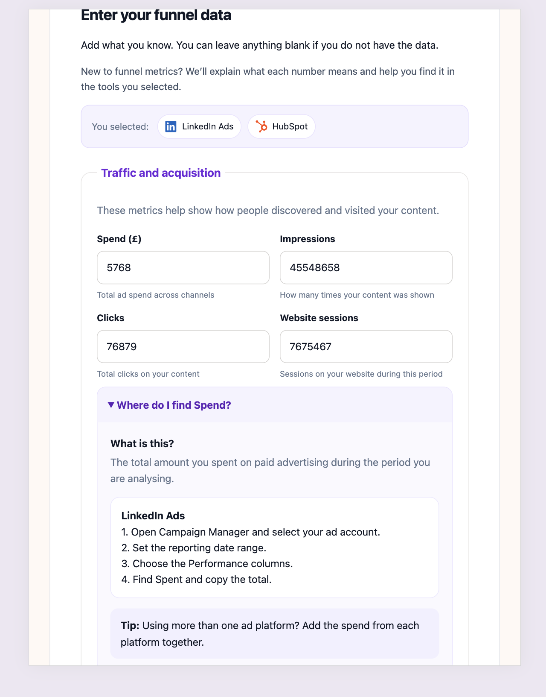
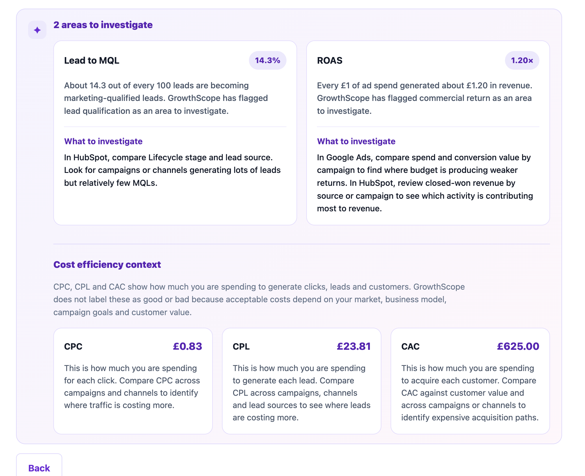

# GrowthScope

GrowthScope is an interactive marketing funnel analysis tool designed to help beginner and intermediate marketers understand their performance data.

It guides users through the metrics they need, explains where common marketing data can be found, validates entered data and calculates key performance indicators such as CTR, CPC, CPL, Lead to MQL conversion rate, CAC and ROAS.

GrowthScope also analyses the available funnel data to identify areas that may need further investigation and provides personalised guidance based on the user's experience level and selected marketing tools. 

## Purpose

Marketing platforms provide large amounts of data, but understanding which metrics matter, where to find them and what they mean can be difficult for less experienced marketers. 

GrowthScope aims to make funnel analysis easier to understand by combining education, calculation and diagnostic guidance in one application.

## User Stories

- As a marketer who is unfamiliar with funnel analysis, I want explanations of what each metric means so that I understand what data I am being asked to provide.
- As a marketer, I want guidance on where common metrics can be found so that I can collect the information from tools I already use.
- As a user who does not have every funnel metric available, I want to analyse the data I do have so that missing information does not prevent me from using the application.
- As a user entering campaign data, I want GrowthScope to warn me when my information is empty, invalid or potentially inconsistent so that I can correct mistakes before analysing it.
- As a marketer, I want key marketing KPIs calculated automatically so that I do not have to calculate them manually.
- As a marketer reviewing funnel performance, I want GrowthScope to highlight areas that may need further investigation so that I know where to focus my analysis.
- As a marketer using specific platforms, I want recommendations that reflect the tools I selected so that the guidance is relevant to my workflow.
- As a beginner or experienced marketer, I want the amount of guidance to change based on my experience level so that the application feels appropriate to my needs.

## User Story Evidence

The following screenshots show how the completed GrowthScope application meets the main user stories.

| User story | Feature evidence | Screenshot |
| --- | --- | --- |
| Understand what each metric means | Beginner guidance explains funnel metrics in plain English. | `documentation/screenshots/responsive/tablet-funnel-768.png` |
| Find data in selected marketing tools | Tool-specific guidance is shown for platforms such as LinkedIn Ads and HubSpot. | `documentation/screenshots/responsive/tablet-funnel-768.png` |
| Continue with incomplete data | GrowthScope allows partial data entry and shows unavailable metrics clearly. | `documentation/screenshots/functional/insufficient-data-pass.png` |
| Receive warnings for inconsistent data | The Review step displays a warning when clicks are higher than impressions. | `documentation/screenshots/functional/inconsistent-data-warning.png` |
| Calculate marketing KPIs automatically | Results calculate CTR, CPC, CPL, Lead to MQL, CAC and ROAS. | `documentation/screenshots/functional/calculation-results-pass.png` |
| Identify areas to investigate | GrowthScope highlights multiple funnel issues when relevant. | `documentation/screenshots/functional/multiple-insights-pass.png` |
| Receive tool-relevant recommendations | Investigation guidance changes based on the tools selected by the user. | `documentation/screenshots/functional/multiple-insights-pass.png` |
| Receive guidance appropriate to experience level | Beginner mode displays additional explanations and guidance. | `documentation/screenshots/responsive/tablet-setup-768.png` |

## Features

- Four-step analysis journey covering Setup, Funnel Data, Review and Results.
- Experience-level selection that changes how much guidance is shown.
- Marketing-tool selection for Google Ads, Meta Ads, LinkedIn Ads, GA4, HubSpot and Salesforce.
- Plain-English metric definitions for less experienced users.
- Tool-specific guidance explaining where common funnel metrics can be found.
- Support for partial datasets so users can analyse the information they have available.
- Validation that prevents completely empty funnel submissions.
- Data-quality warnings for potentially inconsistent funnel relationships.
- Review step allowing users to check their data before analysis.
- Automatic calculation of CTR, CPC, CPL, Lead to MQL conversion rate, CAC and ROAS.
- Personalised diagnostic insights that can identify multiple areas to investigate.
- Recommendations adapted to the marketing tools selected by the user.
- Cost-efficiency context for CPC, CPL and CAC without applying misleading universal benchmarks.
- Responsive layouts for desktop, tablet and mobile devices.
- Keyboard-accessible controls and visible focus states.

## UX Design

GrowthScope was designed to make marketing funnel analysis accessible to both experienced marketers and people who are less familiar with marketing metrics.

The user journey is split into four main stages:

1. Set up the level of guidance required
2. Enter available funnel data
3. Review and validate the data
4. Analyse results and explore opportunities for improvement

The application was wireframed before development to plan the layout, interaction flow and responsive behaviour.

### Desktop wireframes

#### User setup

#### Traffic and acquisition data

#### Leads and qualification data

#### Review

#### Results

#### Early concept: opportunities and scenario planning

An earlier wireframe explored adding scenario-planning functionality so users could model potential funnel improvements. During development, this was removed from the final project scope so the application could focus on reliable funnel analysis, validation and personalised diagnostic guidance.

### Responsive design

The interface was also planned for tablet and mobile devices. On smaller screens, multi-column layouts are reduced or stacked vertically to maintain readability and usability.

#### Tablet setup

#### Tablet funnel data

#### Tablet results

#### Mobile setup

#### Mobile funnel data

#### Mobile results

## Tools and Technologies

### Development

- **HTML5** — used to structure the application and its four-step user journey.
- **CSS3** — used for custom styling, responsive layouts, focus states and visual feedback.
- **JavaScript (ES6)** — used for form validation, step navigation, calculations, personalised guidance and dynamic results.
- **GitHub** — used for version control and project history.
- **GitHub Pages** — used to deploy the live application.

### Design and Planning

- **Figma** — used to create desktop, tablet and mobile wireframes before development.
- **VS Code Web** — used to write and manage the project files.

### Testing and Validation

- **Nu HTML Checker** — used to validate the HTML.
- **W3C CSS Validator** — used to validate the stylesheet.
- **JSHint** — used to check JavaScript quality and syntax.
- **Lighthouse** — used to assess accessibility.
- **Chrome DevTools** — used for responsive testing, debugging and console checks.
- **Safari** — used for cross-browser testing.