# GrowthScope Testing

## Validation
### HTML

The HTML was tested using the Nu HTML Checker.

- Initial testing identified an unclosed `div` in the Funnel Data section.
- The missing closing tag was added and the document was tested again.
- Final result: no errors or warnings.

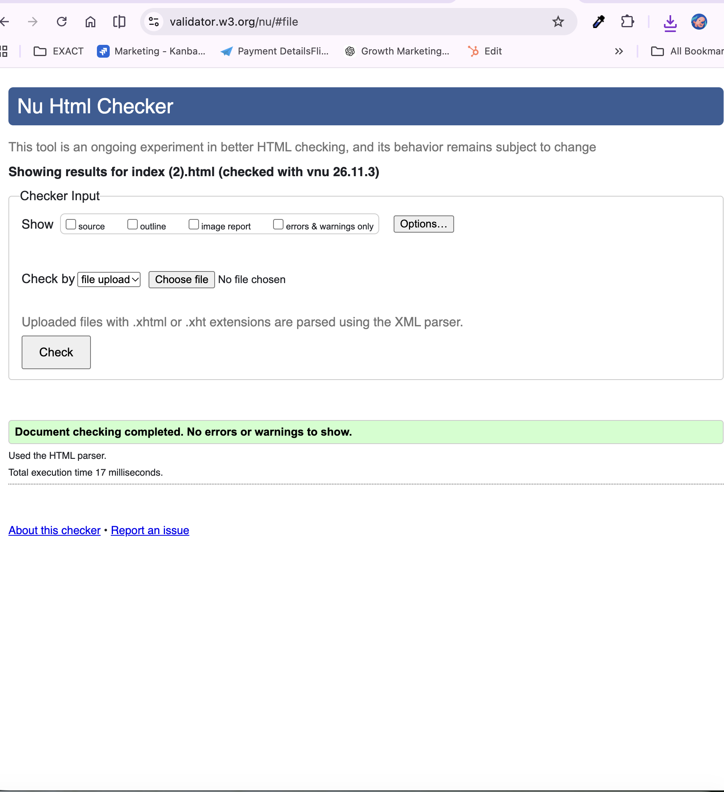

### CSS

The CSS was tested using the W3C CSS Validator.

- An invalid margin declaration was corrected during development.
- Final result: no CSS errors and the stylesheet successfully validated.

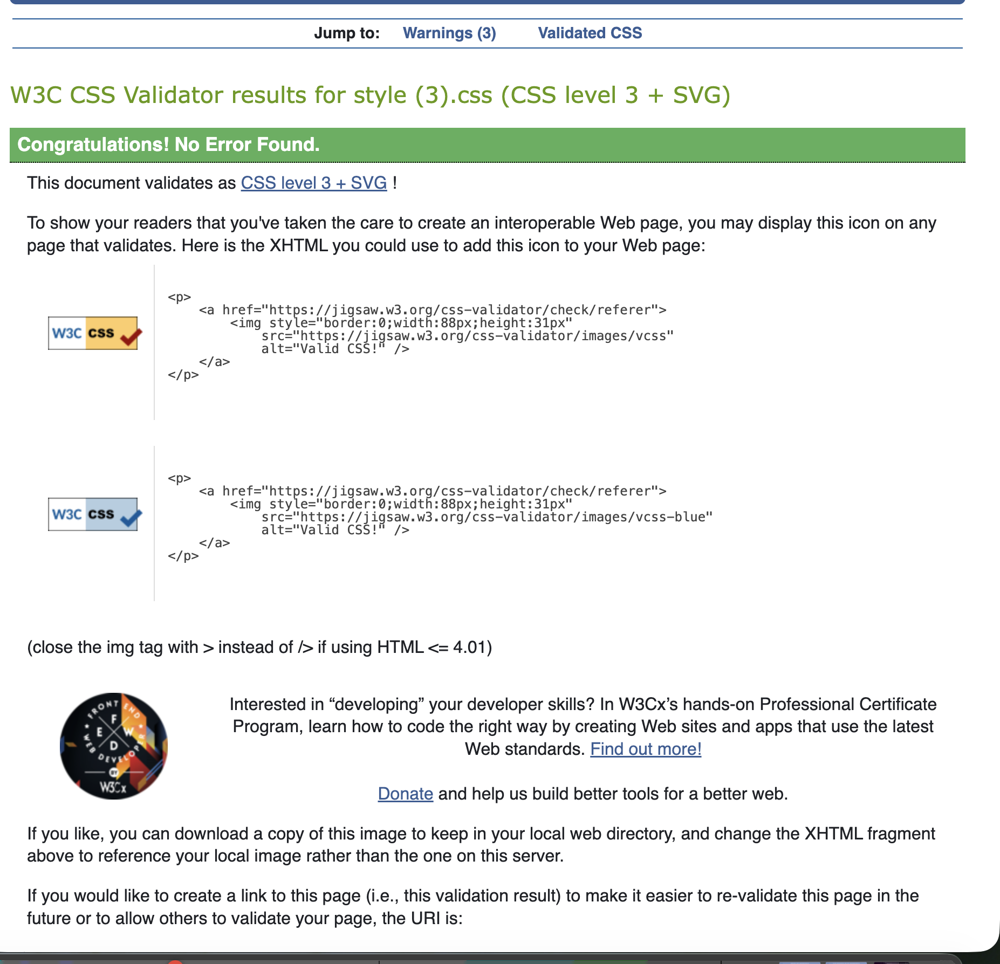

### JavaScript

JavaScript was tested using JSHint.

- JSHint was configured to recognise ES6 syntax during testing because GrowthScope uses features such as `const`, `let` and template literals.
- After configuring the checker for ES6, no JSHint warnings remained.

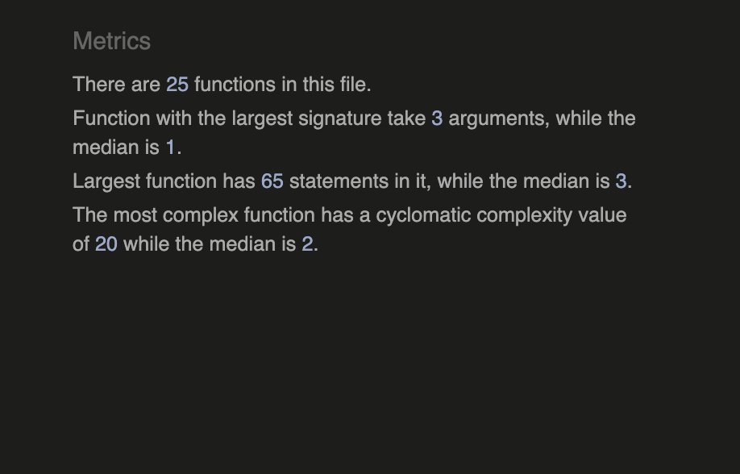

## Functional Testing

The main GrowthScope user journey was tested from setup through to results.

### Setup validation

- Clicking Continue without selecting an experience level prevented the user from moving to the next step.
- A clear error message was displayed.
- The experience options were highlighted with an error state.
- After selecting an experience level and tools, the user could continue successfully.
- Selected tools were carried through to the Funnel Data step.

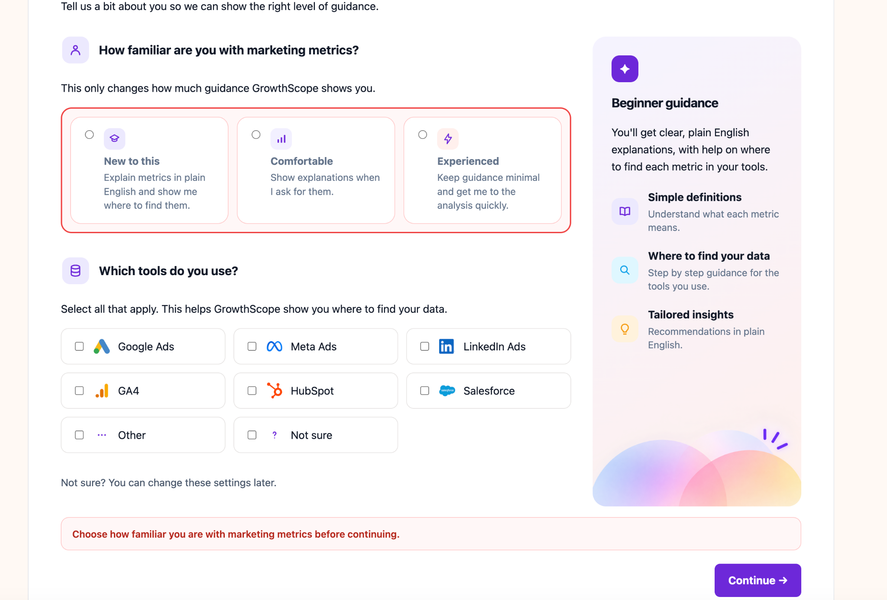

### Funnel data validation

- Submitting the Funnel Data form with all fields empty was blocked.
- The message "Enter at least one funnel metric before continuing" was displayed.

- Invalid funnel relationships were tested.
- When clicks were higher than impressions, GrowthScope displayed a warning on the Review step.
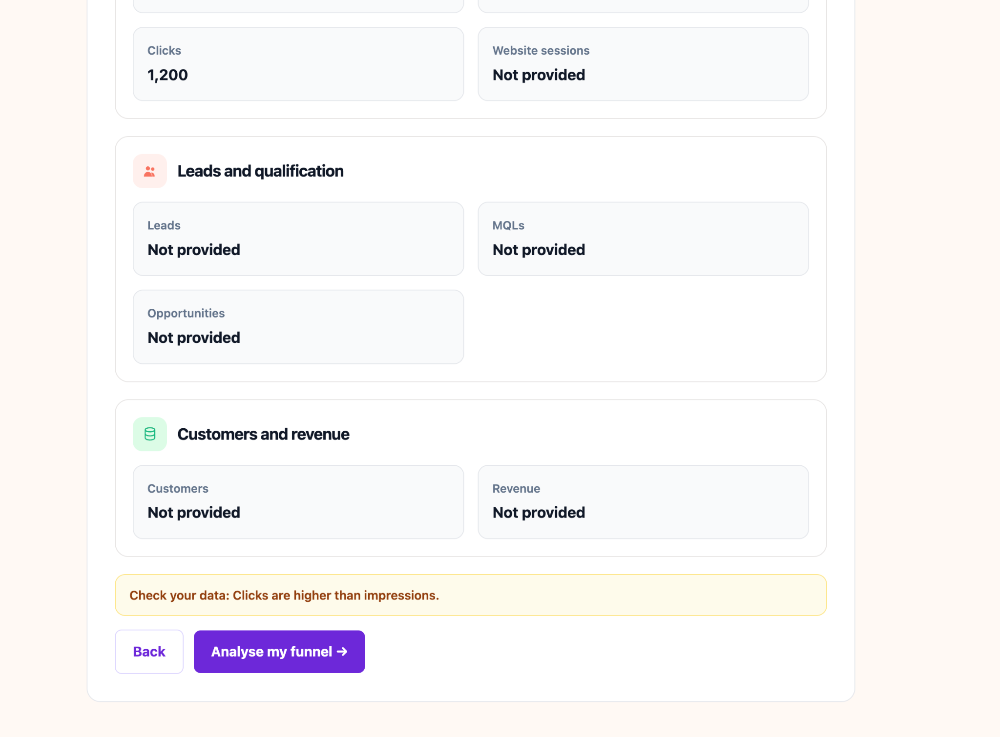

- The warning did not prevent the user from continuing because it was treated as a data-quality warning rather than a blocking error.

### Calculation testing

A full dataset was entered to check the calculated metrics.

Test data:

- Spend: £5,000
- Impressions: 250,000
- Clicks: 6,000
- Website sessions: 5,200
- Leads: 210
- MQLs: 85
- Opportunities: 25
- Customers: 8
- Revenue: £32,000

Expected and actual results:

| Metric | Expected result | Actual result | Status |
| --- | --- | --- | --- |
| CTR | 2.4% | 2.4% | Pass |
| CPC | £0.83 | £0.83 | Pass |
| CPL | £23.81 | £23.81 | Pass |
| Lead to MQL | 40.5% | 40.5% | Pass |
| CAC | £625.00 | £625.00 | Pass |
| ROAS | 6.40× | 6.40× | Pass |

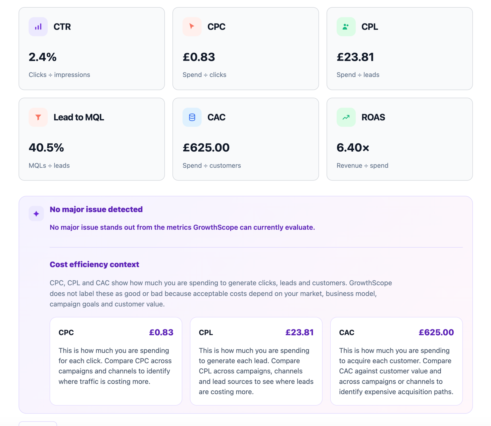

### Personalised insight testing

A second dataset was used to trigger multiple diagnostic insights.

- Lead to MQL: 14.3%
- ROAS: 1.20×

GrowthScope correctly identified two areas to investigate:

- Lead to MQL
- ROAS

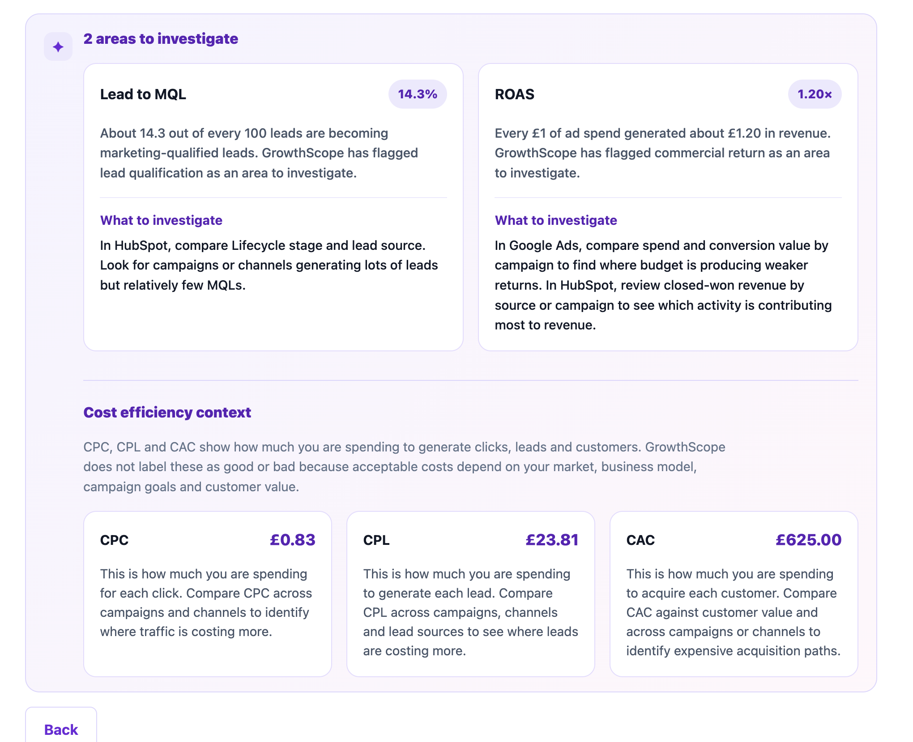

The recommendation text also changed based on the tools selected by the user.

### Insufficient data testing

Only Spend was entered and all other fields were left blank.

- Metrics that could not be calculated displayed "Not available".
- GrowthScope did not create unsupported recommendations.
- A message explained that more connected funnel data was required before a reliable bottleneck could be identified.

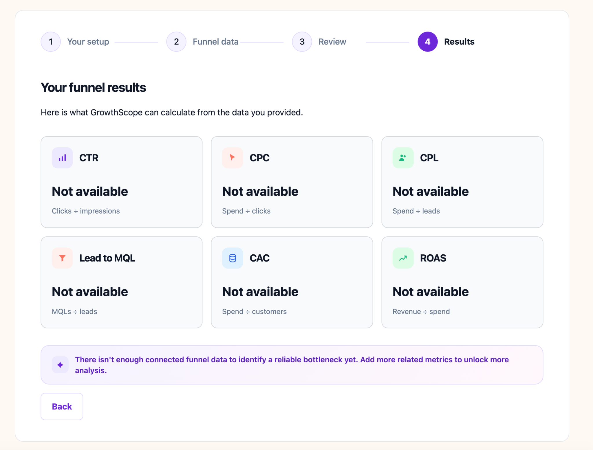

### Navigation and data retention

Back navigation was tested across all steps.

- Data entered in the Funnel Data step remained populated when navigating backwards.
- Selected experience level and tools remained selected.
- Back and Continue controls worked correctly across the full user journey.

## Responsive Testing

GrowthScope was tested using Chrome DevTools at desktop, tablet and mobile widths.

### Desktop

Tested at approximately 1280px width.

- Hero content and dashboard visual displayed side by side.
- How it works cards displayed in three columns.
- Setup, Funnel Data, Review and Results layouts remained aligned.
- No horizontal overflow was identified.

### Tablet

Tested at approximately 768px width.

- Experience and tool-selection controls remained readable.
- Funnel metric fields changed to a two-column layout.
- Review cards remained usable in two columns.
- Results cards adapted to two columns.
- Diagnostic and cost-efficiency content remained readable without overflow.

### Mobile

Tested at approximately 390px width.

- Header navigation wrapped without horizontal overflow.
- Hero content and imagery scaled correctly.
- How it works cards stacked into one column.
- Experience options stacked vertically.
- Progress tracking changed to a compact two-by-two layout.
- Result cards and personalised insight cards stacked into one column.
- Long recommendation text wrapped correctly.
- Buttons remained visible and usable.

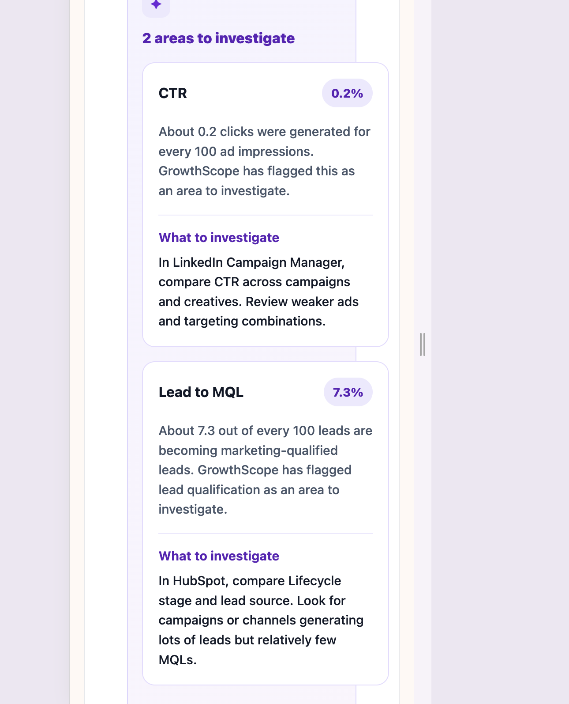

Responsive testing did not identify any blocking layout issues.

## Accessibility Testing

Accessibility was tested using both automated and manual methods.

### Lighthouse

A Lighthouse Accessibility audit was run against the deployed GrowthScope site.

- Accessibility score: 100/100.
- No automated accessibility failures were reported.

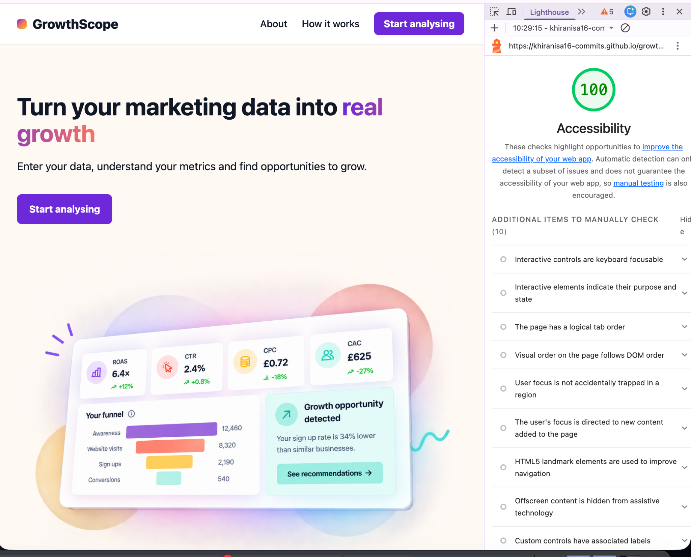

### Keyboard testing

The full GrowthScope journey was tested using keyboard controls only.

- Links, radio buttons, checkboxes, inputs and buttons could be reached using Tab.
- Experience radio buttons and tool checkboxes could be selected using the keyboard.
- Details and summary guidance controls could be opened and closed using Enter or Space.
- Back, Continue and Analyse my funnel controls could be activated using the keyboard.
- Visible focus styles were displayed on interactive controls.
- Keyboard navigation worked across Setup, Funnel Data, Review and Results.

Automated testing was used alongside manual keyboard testing because automated tools cannot detect every accessibility issue.

## Browser Testing

GrowthScope was tested in both Google Chrome and Safari.

### Google Chrome

- Homepage loaded correctly.
- Setup, Funnel Data, Review and Results steps worked as expected.
- Form validation and personalised results worked correctly.
- Back navigation worked.
- Images and responsive layouts displayed correctly.

### Safari

- Homepage loaded correctly.
- The full analysis journey worked as expected.
- Form controls and navigation behaved correctly.
- Results displayed without layout issues.
- Images loaded correctly.

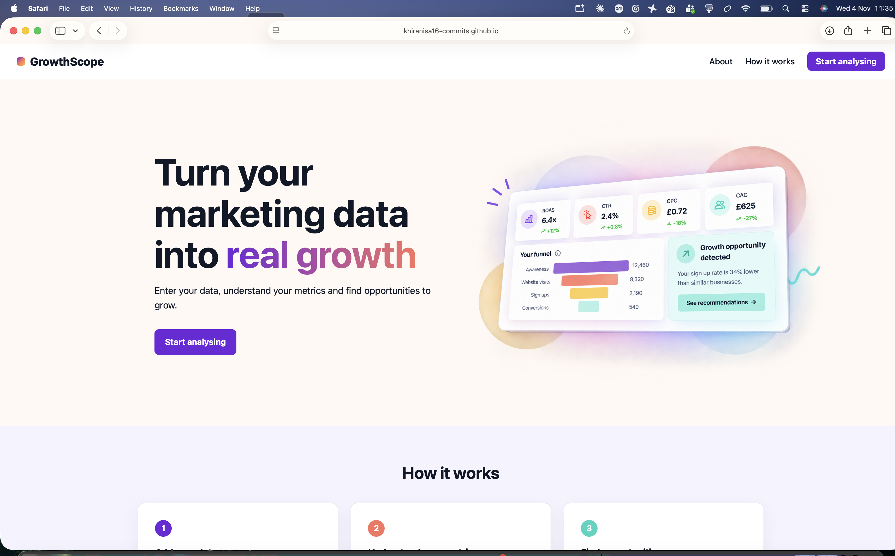

No browser-specific blocking issues were identified.

## Bugs and Fixes

Several issues were identified during development and testing and were corrected before final submission.

### Setup form validation

**Issue:**  
The setup form originally allowed progression problems when no experience level was selected.

**Fix:**  
Validation was added to prevent progression until an experience level is selected. A visible error state and feedback message were added, and the first experience option receives focus.

### Step navigation

**Issue:**  
Earlier versions of the multi-step flow did not always move correctly between Setup, Funnel Data, Review and Results.

**Fix:**  
The JavaScript event handling and hidden states were corrected so each step appears and hides at the correct point in the journey.

### Funnel data validation

**Issue:**  
Users could attempt to continue without entering any funnel data.

**Fix:**  
Validation was added to require at least one funnel metric before continuing.

### Inconsistent funnel data

**Issue:**  
Some combinations of funnel data could be logically inconsistent, such as clicks being higher than impressions or customers being higher than opportunities.

**Fix:**  
GrowthScope now checks for inconsistent relationships and displays warning messages on the Review step without unnecessarily blocking the user.

### Multiple diagnostic insights

**Issue:**  
Earlier diagnostic logic could stop after identifying one funnel issue, which meant other relevant problems were not displayed.

**Fix:**  
The diagnostic logic was changed to evaluate issues independently and store multiple insights so GrowthScope can display all relevant areas to investigate.

### Personalised insight rendering

**Issue:**  
A malformed template literal in the personalised insight renderer caused a JavaScript syntax error and prevented the application from running.

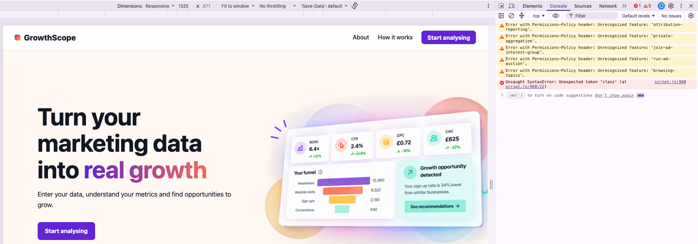

**Fix:**  
The insight rendering block was corrected and retested. The full application flow then worked without JavaScript parse errors.

### HTML structure

**Issue:**  
HTML validation identified an unclosed `div` in the Funnel Data section.

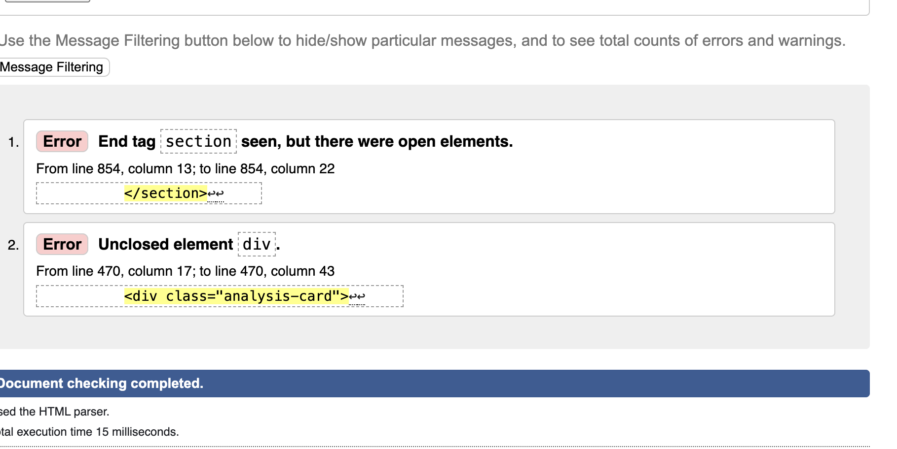

**Fix:**  
The missing closing tag was added and the HTML was revalidated successfully with no errors or warnings.

### CSS validation

**Issue:**  
A margin declaration in the beginner guidance styling used invalid syntax.

**Fix:**  
The margin declaration was corrected and the stylesheet was successfully validated.